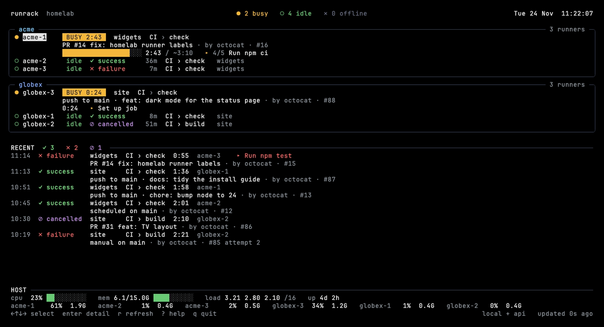

# runrack

A live board of the CI runners on this machine. Which runners exist, whether they are idle or busy, what each one is running right now, how the last jobs ended, and how loaded the host is. Built to sit full screen on a TV attached to a home server, and just as happy in any terminal.


runrack works with no token and no configuration. It reads what the runners already leave on the machine: processes, systemd units, cgroups and the runner's own `_diag` logs. With a GitHub token it adds GitHub's view: online state, labels, the full step list and the run title.

It never changes anything. No start, stop, restart, register or cleanup. The one file it writes is its own list of finished jobs, so history survives a restart and runners whose container is deleted after each job.

## Supported runners

| Runner | Status |
|---|---|
| GitHub Actions self-hosted runner on the host (systemd unit) | supported |
| GitHub Actions self-hosted runner inside Incus system containers (default project) | supported |
| GitHub Actions self-hosted runner in Docker or a user session | busy and idle only |
| GitLab Runner, Forgejo and Gitea act_runner, Woodpecker, Buildkite, Jenkins, Azure Pipelines | planned, see [docs/providers.md](docs/providers.md) |

Linux only for now. Discovery reads `/proc` and cgroup v2.

## Install

```sh
curl -fsSL https://raw.githubusercontent.com/YoanWai/runrack/main/install.sh | sh
```

The script picks `amd64` or `arm64`, downloads the latest release (or `RUNRACK_VERSION`), checks it against `checksums.txt` and installs to `~/.local/bin` (or `RUNRACK_INSTALL_DIR`). No sudo. Binaries and checksums are also on the [releases page](https://github.com/YoanWai/runrack/releases).

From source, with Go 1.27:

```sh
go install github.com/YoanWai/runrack/cmd/runrack@latest
```

## Usage

```sh
runrack                 # the live board
runrack --json          # one full snapshot as JSON, then exit
runrack --once          # the board printed once, no TTY needed
runrack doctor          # which sources work, and why not
runrack --demo          # a made-up rack, to try it without runners
```

| Flag | Meaning |
|---|---|
| `--no-api` | local data only, even when a token is around |
| `--color auto\|none\|16\|256\|truecolor` | color profile, detected by default |
| `--glyphs auto\|unicode\|console\|ascii` | symbol set, `console` on the Linux console, also inside a tmux attached to it |
| `--containers GLOB` | only look inside Incus containers matching the glob |
| `--timeout 10s` | time limit for `--json`, `--once` and `doctor` |
| `--width N` | board width for `--once` |

Keys: arrows or `hjkl` move (down from the last runner walks into RECENT), `enter` opens a runner or a finished run, `esc` goes back, `r` refreshes every source and retries the API, `?` shows the legend, `q` quits.

## What each run shows

| Where | What |
|---|---|
| busy runner | elapsed time, repository, workflow and job, then the trigger (`PR #14` and its title, or `push to main` and the commit subject, `manual on main`, `scheduled on main`), who started it and the run number, then progress against the last run of the same job and the current step as `4/9 Run npm ci` |
| idle runner | result, age, workflow and job of its last run, and the repository when it fits |
| RECENT row | finish time, result, repository, workflow and job, duration, runner and the step that failed, then the trigger, who started it and the run number |
| `enter` on a runner or a RECENT row | everything above plus event, branch and base, commit, run attempt, every step with its result and duration, and the link to the run on GitHub |

Finished jobs are kept in `$XDG_STATE_HOME/runrack/history.json` (default `~/.local/state/runrack/history.json`, private to the user), up to the last 60.

`--json` prints a `runrack.snapshot/v1` document with RFC 3339 UTC times and durations in seconds. Fields are only ever added within v1.

## What runrack reads

| Source | What for | How often |
|---|---|---|
| `/proc/<pid>/stat` for every process | find `Runner.Listener` and `Runner.Worker` by process name, busy or idle, elapsed time | every second |
| `/proc/<pid>/cmdline` and `cgroup` of runner processes only | runner directory, host unit or container | every second |
| `systemctl list-units 'actions.runner.*'` on the host and in each container | runners that are stopped or failed | every minute where runners were found, every 10 minutes elsewhere, and when a runner restarts |
| `incus list -f json` | containers, their state and process count | every minute, and when a container's cgroup disappears |
| `/sys/fs/cgroup/lxc.payload.<container>/cpu.stat` and `memory.current` | container CPU and memory | every 5 seconds |
| `<runner>/.runner` | runner name, id and GitHub scope | once per runner start |
| `<runner>/_diag/Runner_*.log` | runner version and configured labels | once per runner start |
| `<runner>/_diag/Worker_*.log` | repository, workflow, job, branch, actor, PR title or commit subject, steps with their results, and result | when a job starts, every 3 seconds while it runs, every minute for history |
| `/proc/loadavg`, `/proc/stat`, `/proc/meminfo` | host load strip | every 2 seconds |

Inside containers runrack runs `incus exec <container> -- head|ls|grep|systemctl ...` with a fixed argument list. Inside tmux it asks `tmux display-message` which terminal the client runs in. Every command goes through one allowlist, and runrack never reads `.credentials`, `.credentials_rsaparams`, `.env` or `.path`. On the host it refuses to follow symlinks in runner directories. Text from logs and the API is stripped of control characters before it reaches the screen. From the Worker log's job message it keeps only the repository, workflow, run, ref, event, actor and commit fields, the PR title or the pushed commit's subject, and the number of steps. Everything else in that message, masked secrets included, is skipped by the JSON decoder and never stored or printed.

## Permissions

- **Incus containers:** membership in `incus-admin`, the same access `incus exec` needs.
- **Host runners:** read access to the runner directory and its `_diag`. When `_diag` is not readable runrack still shows the runner busy or idle with elapsed time, and `runrack doctor` says which user owns it.
- **GitHub token (optional):** first found of `RUNRACK_GITHUB_TOKEN`, `GH_TOKEN`, `GITHUB_TOKEN`, then `gh auth token`. The token is never printed.
  - Org runners: fine-grained "Self-hosted runners: read", or classic `admin:org`. A default `gh auth login` token has no `admin:org`, so that endpoint answers 403 and the footer says so.
  - Runs and jobs: fine-grained "Actions: read", or classic `repo`.
  - When an endpoint answers 401, 403 or 404 it stays off for 15 minutes, or until you press `r`. A rate limit only slows the polling down.

## Run it on a TV console

runrack lays out to the terminal size, from 80x24 up to a 4K console (240x67 with the 16x32 Terminus font). On the Linux console, or in tmux attached to it, `auto` picks the console glyph set and the 16 color profile. To force them:

```sh
runrack --glyphs console --color 16
```

The console set only uses symbols that the kernel's default map and Terminus console fonts can draw. Colors stay within the 8 base colors, because a 512 glyph console font (such as `Uni2-TerminusBold32x16`) spends the bright bit on glyphs. That is also why a busy runner gets a filled badge: yellow text turns brown there. A 256 glyph font such as `Lat15-TerminusBold32x16` gives the full 16 colors back.

To start it on boot, run it as a service that owns tty1. No login shell is involved, so a missing binary leaves a failed service instead of an open shell on the TV keyboard:

```ini
# /etc/systemd/system/runrack-tv.service
[Unit]
Description=runrack on the TV
After=getty@tty1.service
Conflicts=getty@tty1.service

[Service]
User=<user>
Environment=TERM=linux
ExecStart=/home/<user>/.local/bin/runrack
StandardInput=tty
StandardOutput=tty
TTYPath=/dev/tty1
TTYReset=yes
TTYVHangup=yes
Restart=always
RestartSec=5

[Install]
WantedBy=multi-user.target
```

```sh
sudo systemctl daemon-reload
sudo systemctl enable --now runrack-tv
```



## Contributing

See [CONTRIBUTING.md](CONTRIBUTING.md). Security reports go through [SECURITY.md](SECURITY.md).

## License

[Apache-2.0](LICENSE)
